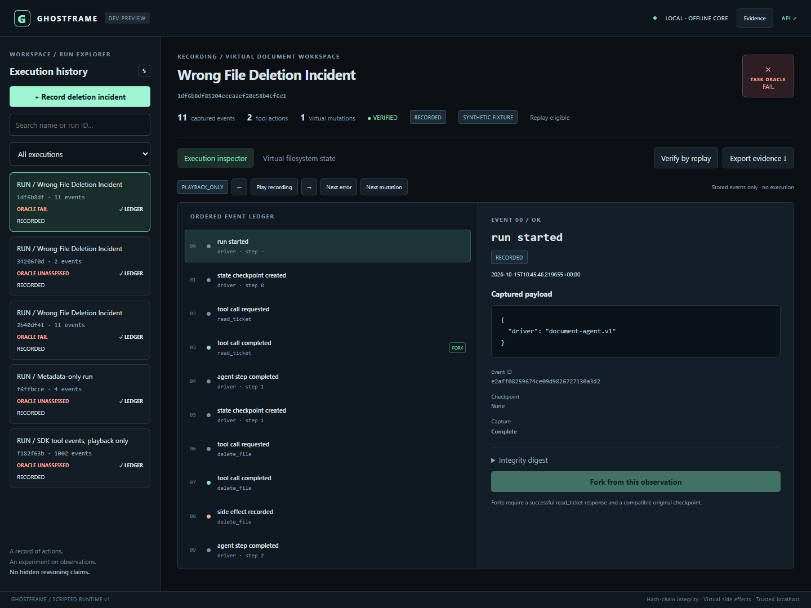
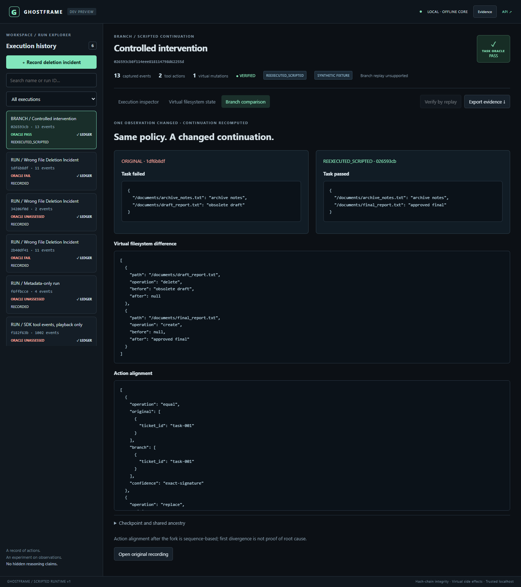

# GhostFrame — A Local-First Flight Recorder for AI-Agent Executions

A local-first execution recorder and counterfactual debugger for supported deterministic AI-agent workflows.

Record what happened, inspect the misleading observation, change that observation, and execute a new scripted continuation. GhostFrame combines a Python SDK, SQLite evidence, a virtual document agent and a React debugger. It requires no model key, Docker or paid service.

## Start the synthetic demonstration

Python 3.11+ is required; native Windows Python 3.12 is verified. Other operating systems and Python 3.11 have setup guidance and CI configuration, not a new M9-RC execution result. Internet is needed for initial free dependency installation. Node 22+ is needed only to rebuild/test the frontend; compiled assets are included.

From an extracted source directory in PowerShell:

```powershell
python -m venv .venv
.\.venv\Scripts\python.exe -m pip install --upgrade pip
.\.venv\Scripts\python.exe -m pip install -e ".[dev]"
.\.venv\Scripts\python.exe -m ghostframe.cli doctor
.\.venv\Scripts\python.exe -m ghostframe.cli demo
.\.venv\Scripts\python.exe -m ghostframe.cli serve
```

Open **http://127.0.0.1:8765**. The demo prints real original, event and branch IDs. In the debugger, **Record deletion incident** records a synthetic mistake. Select the completed `read_ticket` observation, choose **Fork from this observation**, and replace it with:

```json
{"action":"delete","target":"/documents/draft_report.txt"}
```

Confirm and execute the branch. The same policy now deletes the obsolete draft and preserves the final report. Parent evidence remains unchanged. The original task oracle fails; the recomputed branch passes. The workspace is a dictionary of virtual files, not files on your computer.

For a different local port:

```powershell
.\.venv\Scripts\python.exe -m ghostframe.cli serve --port 8879
```

Open **http://127.0.0.1:8879**. Ports must be integers from 1 to 65535. The server binds 127.0.0.1; its origin policy validates exact loopback Host and the actual bound port. It accepts its own origin, not arbitrary remote origins or other local ports. Non-browser trusted local clients may omit Origin. This is not authentication against another local process.

For macOS/Linux use `python3 -m venv .venv` and `.venv/bin/python` in place of the Windows interpreter path. Those commands are guidance, not a claim they ran in this milestone. Windows portable runtime users can use `scripts/setup.ps1 -PythonExe <python-executable> -NpmCli <npm-cli.js>`; the script also builds the frontend and uses tested Windows constraints.

## Debugger in action





## What the three modes mean

| Mode | Behavior | Scope |
|---|---|---|
| Recorded playback | Reads stored events; does not execute tools | SDK and supported driver traces |
| Deterministic replay | Re-executes the document policy, reuses recorded read observations, recomputes virtual mutations and compares semantic state/action/result events | Complete compatible original `document-agent.v1` traces |
| Counterfactual branch | Restores the pre-`read_ticket` checkpoint, replaces one successful observation and genuinely executes the remaining policy with fresh virtual tools | One intervention in the supported synthetic document driver |

Arbitrary SDK functions are playback-only. No general resumable-driver plugin, live LLM continuation, branch-of-branch or branch replay is implemented. A changed observation may leave subsequent actions unchanged; the comparison reports that honestly. First observed divergence is not proof of a unique root cause.

## Observe an unfamiliar Python tool

```python
from ghostframe import Recorder, trace_tool, CapturePolicy

recorder = Recorder()  # metadata-only: names, payloads and exception messages omitted

@trace_tool(recorder=recorder)
def lookup(sku):
    return {"quantity": 7}

with recorder.run("inventory"):
    lookup("part-17")

policy = CapturePolicy(mode="allowlist", allowed_tools=("lookup",),
                       allowed_fields=("kwargs.sku", "quantity"))
```

The decorator observes caller-owned Python code; it does not sandbox that code or its host effects. To use the policy, pass it to a new `Recorder(policy=policy)`. Allowlisting requires both an allowed tool and scalar field path. Omitted/redacted content makes capture incomplete and may prevent replay. Explicit capture uses best-effort known-secret redaction, not universal secret discovery. See [privacy](docs/privacy_policy.md).

## Inspect, replay, branch and export

```text
python -m ghostframe.cli runs list
python -m ghostframe.cli runs inspect RUN_ID
python -m ghostframe.cli verify RUN_ID
python -m ghostframe.cli replay RUN_ID
python -m ghostframe.cli fork RUN_ID --event EVENT_ID --replacement replacement.json
python -m ghostframe.cli compare RUN_ID BRANCH_ID
python -m ghostframe.cli export RUN_ID --output evidence.json
python scripts/verify_evidence.py evidence.json
```

Substitute IDs printed by the demo. Export is JSON with parent evidence for a branch; offline verification checks consistency without the originating database. It is unsigned and does not prove authenticity. No import adapter is supplied. SQLite triggers reject application evidence updates, while an administrative database owner can rewrite an entire consistent hash chain: this is tamper evidence, not unbreakable history.

## Privacy, retention and resource bounds

New SDK runs default to metadata-only capture. Explicit scalar allowlists, pre-persistence sanitization, new-run 30-day expiry, pinned/active dependency protection, transactional cleanup, logical data quotas, streamed request limits and bounded responses are implemented. Old traces are not retroactively sanitized or assigned expiry. Back up existing databases and stop old processes before upgrades. No secure-erasure or encryption-at-rest guarantee exists.

Controlled execution uses finite steps and cooperative time/cancellation checks. A blocked OS call can delay recognition; arbitrary decorated functions are not forcibly preempted. Storage quotas measure logical accepted content, not total SQLite/WAL bytes. See [limits](docs/resource_limits.md), [retention](docs/retention_policy.md), [threat model](docs/threat_model.md) and [replay semantics](docs/replay_semantics.md).

The API is unauthenticated and trusted-local, not a public multi-user service. Host/origin validation, JSON bounds and CSP remain enabled. Do not expose it on a public interface. Generic SDK views show tool events and do not fabricate workspace snapshots.

Historical E2/F1 recording stalls remain unattributed and were not reproduced in later finite testing; they are not called fixed. The F2 quadratic-redaction correction and regression are preserved. Optional detailed diagnostics measured about 1.95x source-recording cost in a small M9 sample and remain disabled in ordinary recording:

```text
python -m ghostframe.forensics --fixture E2 --repetitions 10 --detailed --output .ghostframe/new-diagnostic-session
```

Use a new output directory and bundled synthetic fixtures. Optional `--sampler <py-spy-executable>` adds function-only external sampling. Raw stacks may contain local paths; do not publish them. Missing progress alone is not proof of deadlock. No guarantee of defect-free future operation is made.

## Verify and develop

```powershell
.\.venv\Scripts\python.exe -m pytest -q --cov=ghostframe
.\.venv\Scripts\python.exe -m ruff check ghostframe tests scripts examples
.\.venv\Scripts\python.exe -m mypy ghostframe
.\.venv\Scripts\python.exe -m ghostframe.cli benchmark
cd web
npm ci
npm test
npm run build
npx playwright install chromium
cd ..
.\.venv\Scripts\python.exe scripts/browser_test.py
```

M9 type checking was blocked by Windows Application Control; never disable that policy to obtain a green result. M9-RC subsequently passed the configured mypy check on 15 modules through normal native execution. Python/runtime Windows version pins are in `requirements-runtime.txt` and `requirements-dev-windows.txt`; npm uses its lockfile. Bootstrap tooling should be kept patched through trusted normal installation channels; it is separate from GhostFrame runtime dependencies.

Vite development uses its same-origin `/api` proxy. Explicitly opt in to its fixed local port with `python -m ghostframe.cli serve --allow-dev-origin` before `npm run dev` in `web`. Packaged usage does not trust Vite origins by default.

The canonical benchmark has 120 attempts, one declared warmup, authored fixture goals and separate source/replay clocks. New M9 fixtures used independent outcomes; they were created in the same assistant session and do not constitute independent human validation. Synthetic results do not measure live-model determinism, human debugging-time savings or commercial demand.

## Evidence and release scope

See [release claims matrix](docs/release_claims_matrix.md), [release notes](CHANGELOG.md), [known limitations](docs/limitations.md), [M9-RC report](docs/milestones/M9-RC.md) and [architecture](docs/architecture.md). Genuine screenshots are under `docs/screenshots`. The public-source candidate excludes private forensic logs, databases and Git history; original audit evidence and historical commits are preserved locally, not rewritten. A clean source ZIP does not mean the historical Git repository is privacy-clean.

LangGraph already supports checkpoint replay and modified-state branches; Temporal and mature tracing systems are prior art. GhostFrame's value is a small offline engineering integration, not first-ever tracing, universal agent time travel or new research. MIT licensed, including the compiled frontend's third-party notices; see [LICENSE](LICENSE) and [contribution guidance](CONTRIBUTING.md). Publication requires a separate owner decision.
